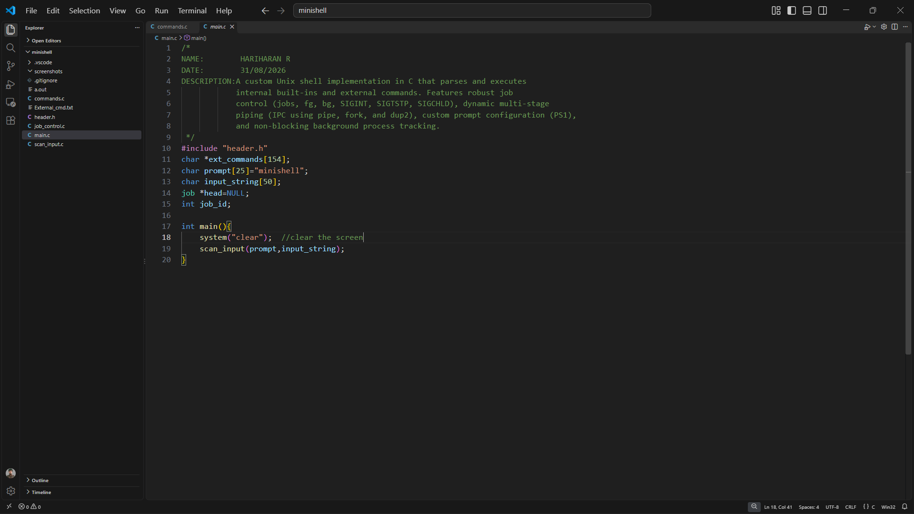
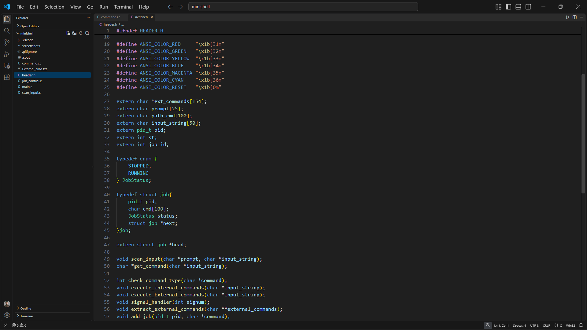
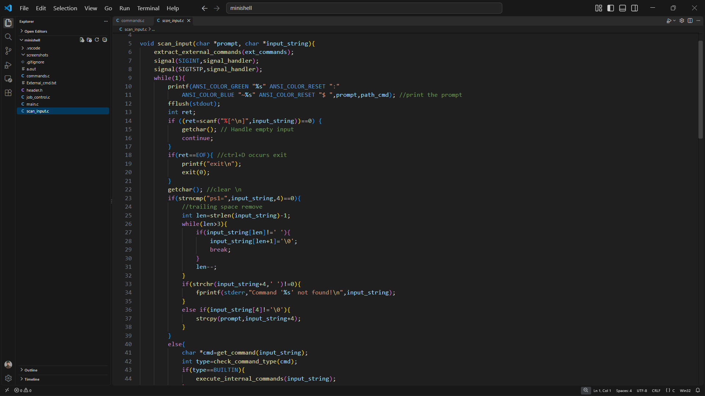
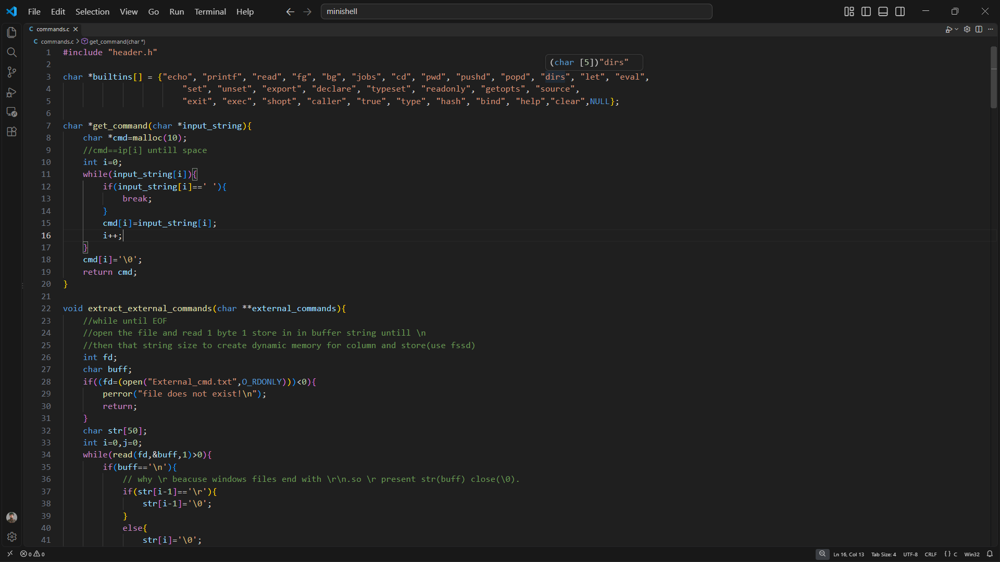
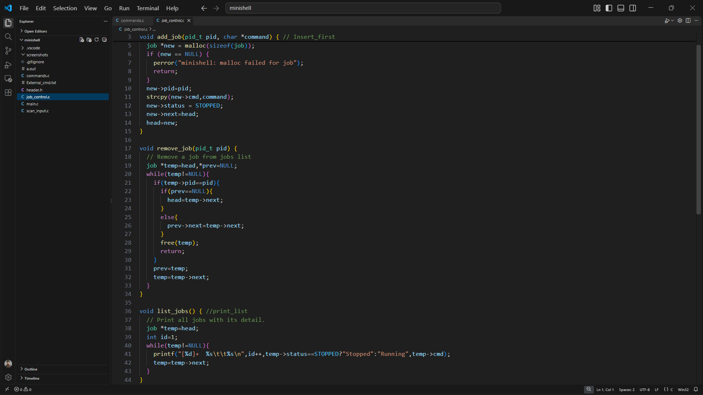
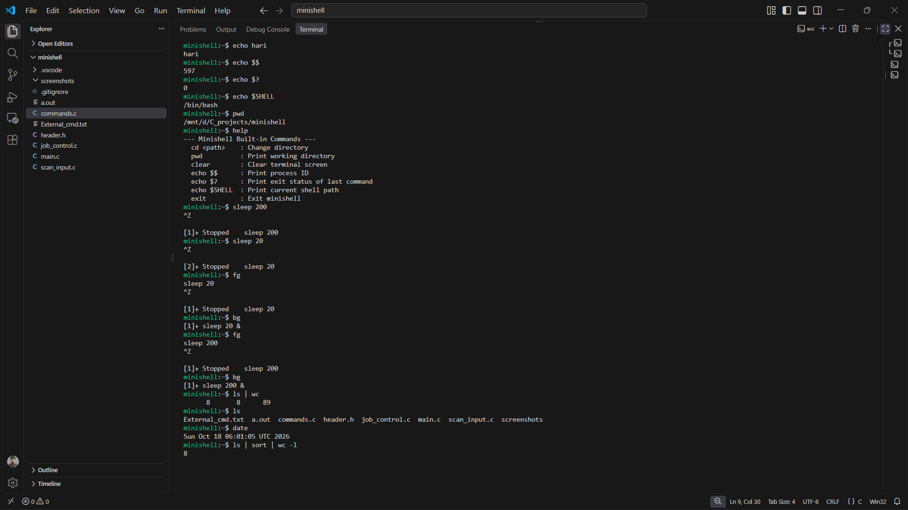

# 🐚 Minishell: Custom Unix Command Line Interpreter (C)


---

## 📌 Overview
**Minishell** is a lightweight, POSIX-compliant Unix command-line shell implemented from scratch in C. Designed to emulate core GNU Bash functionality, it acts as a process orchestrator and execution layer bridging user input with OS system routines.

The application incorporates a decoupled command classification engine (built-in vs. external binary execution), POSIX signal routing (`SIGINT`, `SIGTSTP`, `SIGCHLD`), interactive job control (`jobs`, `fg`, `bg`) backed by a dynamic linked list job tracking table, inter-process communication via multi-stage IPC pipeline loops (`pipe`, `dup2`), and dynamic prompt customizability (`PS1`).

---

## 🚀 Features

* 💻 **Dual Execution Engine**:
  * **Built-in Commands**: Directly executed within the parent shell context without spawning sub-processes (`cd`, `pwd`, `clear`, `echo`, `exit`, `help`, `jobs`, `fg`, `bg`).
  * **External System Commands**: Dynamically resolved via path lookups and dispatched using POSIX process primitives (`fork()` and `execvp()`).
* 🔄 **Dynamic Multi-Command Pipelining (IPC)**:
  * Implements arbitrary command chaining via UNIX pipes (`cmd1 | cmd2 | ... | cmdN`).
  * Uses `pipe()`, `fork()`, and `dup2()` descriptor redirection, dynamically bridging file descriptors (`STDOUT_FILENO` $\rightarrow$ `STDIN_FILENO`) before cleaning up descriptor leaks with `wait()` barriers.
* 🚦 **Full POSIX Signal Handling & Job Suspension**:
  * **`SIGINT` (Ctrl+C)**: Resets active interactive terminal prompts without terminating the parent shell.
  * **`SIGTSTP` (Ctrl+Z)**: Suspends running child foreground processes gracefully via `WUNTRACED`, capturing exit states and moving targets to a managed job queue.
  * **`SIGCHLD`**: Traps asynchronous background terminations using non-blocking wait loops (`WNOHANG`) to prevent zombie process leaks.
* 📋 **Process Job Control Engine**:
  * **`jobs`**: Inspects and lists all suspended (`Stopped`) or backgrounded (`Running`) processes.
  * **`fg`**: Brings backgrounded or suspended processes back into the active foreground using `kill(pid, SIGCONT)` and blocking `waitpid()`.
  * **`bg`**: Resumes halted tasks silently in the background.
* 🎨 **Environment Variables & Configurable Prompt (`PS1`)**:
  * Supports runtime custom prompt string overrides using `ps1=<custom_prompt>`.
  * Dynamic directory formatting displaying `~<cwd>` path markers with ANSI terminal color escapes.
  * Parameter expansion for process attributes: `$$` (current shell PID), `$?` (exit status of the last executed command), and `$SHELL` (active system shell string).

---

## 🛠️ Tech Stack

* **Language**: C (C99 / C11 Standard)
* **Compiler**: GCC
* **Target Environment**: Linux / POSIX
* **Operating System Concepts**:
  * Process Lifecycle Control: `fork()`, `execvp()`, `wait()`, `waitpid()`, `exit()`
  * Inter-Process Communication (IPC): `pipe()`, `dup()`, `dup2()`
  * POSIX Signal Dispatching: `signal()`, `kill()`, `SIGINT`, `SIGTSTP`, `SIGCHLD`, `SIGCONT`
  * File System Navigation: `getcwd()`, `chdir()`, `open()`, `read()`, `close()`
  * Dynamic Memory Allocation: `malloc()`, `free()`, custom singly linked job tracking chains

---

## 📂 Project Structure

```text
├── main.c              → Shell launch sequence, initialization, and loop driver
├── header.h            → Core system includes, macros, prototypes, and job data structures
├── scan_input.c        → Interactive prompt, PS1 parser, signal dispatching, and process forks
├── commands.c          → Built-in handlers, external command extraction, and IPC pipe engine
├── job_control.c       → Singly linked list job queue (add, remove, and list processes)
├── External_cmd.txt    → External system binary whitelist lookup catalog
└── Makefile            → Automated build and cleanup utility
```
---
## ⚙️ How It Works
1. **Initializes Environment & System Catalogs:**
   - Clears the terminal screen and populates the external command lookup array by parsing the catalog from `External_cmd.txt`.
   - Binds POSIX signal handlers (`signal()`) for `SIGINT` (Ctrl+C) and `SIGTSTP` (Ctrl+Z) to retain shell control without unintended termination.
2. **Scans & Evaluates Command-Line Input:**
   - Renders a color-coded prompt showing current path markers (`~<cwd>`).
   - Reads user input strings dynamically; if an EOF (Ctrl+D) character is detected, the shell exits cleanly.
   - Evaluates environment overrides such as `ps1=<custom_prompt>` to dynamically update interactive prompt headers.
3. **Classifies & Dispatches Command Types:**
   - Strips the primary keyword to determine execution type: `BUILTIN`, `EXTERNAL`, or `NO_COMMAND`.
   - **Built-in Path:** Executes directly in the parent process without spawning child processes (`cd`, `pwd`, `echo`, `clear`, `jobs`, `fg`, `bg`, `exit`, `help`).
   - **External Path:** Delegates execution to child processes managed by POSIX system calls.
4. **Handles Process Cloning & Signal Trapping:**
   - Calls `fork()` to spawn child worker processes for external binaries.
   - Resets signal behavior to default (`SIG_DFL`) within the child process and runs commands via `execvp()`.
   - Uses `waitpid(pid, &st, WUNTRACED)` in the parent shell to monitor foreground commands; if a process is suspended via Ctrl+Z, it is dynamically captured and registered into the job tracking list.
5. **Executes Multi-Stage Pipelining (IPC):**
   - Parses piped chains (`|`) and divides inputs into sequential sub-command matrices.
   - Creates communication channels using `pipe(fd)` and clones file descriptors with `dup2()`, streaming stdout of preceding tasks directly into stdin of succeeding tasks.
   - Uses `while (wait(NULL) > 0)` barriers to ensure all pipeline stages complete before returning control to the terminal.
6. **Manages Asynchronous Job Control & Cleanup:**
   - Employs non-blocking wait routines (`waitpid(-1, &status, WNOHANG)`) inside `SIGCHLD` listeners to harvest terminated background processes.
   - Manages state toggling (`STOPPED` vs. `RUNNING`) and transfers tasks between background and foreground using `SIGCONT`.

---

## 🔐 Validation & Safety Highlights

- **Descriptor Redirection & Leak Prevention:**
  - Preserves standard input using `dup(0)` before pipeline execution and restores it via `dup2()` after command cycles complete, preventing permanent stream redirections.
  - Closes unused pipe descriptor endpoints (`close(fd[0])` and `close(fd[1])`) across parent and child branches to prevent pipe deadlocks and descriptor table leaks.
- **Zombie Process Elimination:**
  - Employs non-blocking `waitpid(-1, &status, WNOHANG)` loops inside `SIGCHLD` signal handlers to clean up terminated background processes and remove their associated job nodes.
- **Dynamic Memory & Buffer Safeguards:**
  - Evaluates memory allocations when tracking jobs (`malloc`), warning if memory limits are exceeded.
  - Dynamically sizes argument vectors for `execvp()` based on whitespace parsing, terminating token arrays with `NULL` to prevent out-of-bounds pointer reads.
- **Strict Syntax & Directory Verification:**
  - Strips whitespace during `ps1=` updates, preventing malformed prompt formatting.
  - Inspects paths on directory changes (`cd`), intercepting non-existent destinations via `perror()` rather than crashing the shell loop.

---

## 🧠 Key Learnings
- **Process Lifecycle & Concurrency:** Gained hands-on experience orchestrating process creation, execution, and suspension using `fork()`, `execvp()`, `waitpid()`, and status inspection macros (`WIFSTOPPED`, `WIFEXITED`, `WEXITSTATUS`).
- **IPC Pipelines & File Descriptor Duplication:** Designed multi-stage data pipelines using `pipe()` and `dup2()`, mastering POSIX standard stream redirection and file descriptor table mechanics.
- **Asynchronous Signal Handling:** Engineered robust signal interception for `SIGINT`, `SIGTSTP`, and `SIGCHLD`, avoiding race conditions and ensuring non-blocking background process collection.
- **Job Control Architecture:** Implemented dynamic singly linked lists to maintain process IDs, execution strings, and status states (`STOPPED` vs. `RUNNING`).
- **Defensive CLI Engineering:** Developed modular C routines for input tokenization, dynamic prompt updates, and structured system-level error handling.

---

## 📸 Screenshots

### Main:


### Header:


### Scan_Input:


### Command-extract from input:


### Signal_Handler:


### Job Control Workflow (Ctrl+Z, jobs, bg, fg):


### Output:


---

## 📈 Future Enhancements
- **I/O Redirection Support:** Implement input/output redirection operators (`>`, `>>`, `<`) to pipe streams to and from text files.
- **Quote Sanitization:** Add parsing support for single (`''`) and double (`""`) quotes to allow arguments containing spaces.
- **Interactive History Navigation:** Integrate command history recall with terminal raw mode or the GNU Readline library.

---

## 🙌 Author
**Hariharan R**  
🎓 2025 Graduate | Electronics and Communication Engineering  
🔧 Aspiring Embedded Systems & Firmware Engineer  
💻 Strong in C Programming, POSIX Systems, Data Structures & Linux Internals  
⚙️ Interested in Embedded Systems, RTOS, Microcontrollers & Low-Level Development  

---

## 🌟 Support
If you like this project:

⭐ Star this repository  
🍴 Fork and improve it  
📢 Share with others  

---

## 📬 Contact

- 📧 Email: hariharanrbe@gmail.com
- 💼 LinkedIn: https://www.linkedin.com/in/hariharanrbe/

---

## 🏷️ Tags
`C Programming` `Linux Systems` `POSIX API` `Operating Systems` `Process Management` `IPC` `Pipes` `Job Control` `Signals` `Data Structures` `Low-Level Development`
